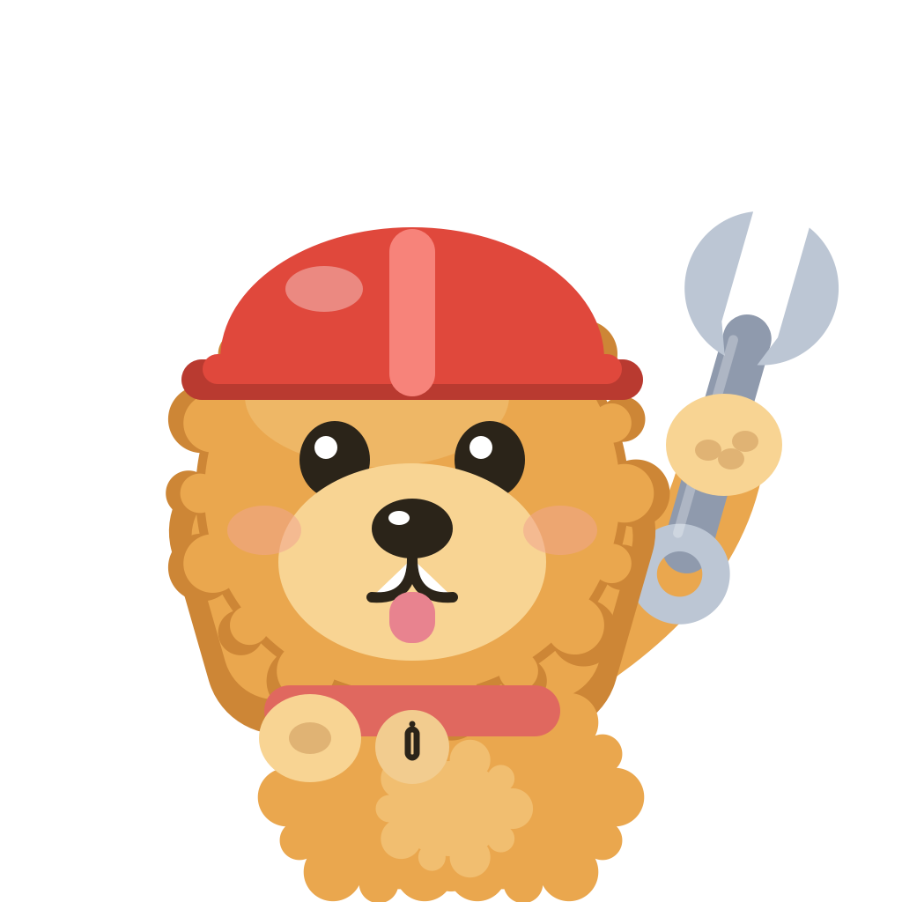

# AI Dialog Manager · AI 会话管理器

<p align="center">
  
</p>

<p align="center">
  <b>一个窗口，管住所有 AI CLI 的聊天记录。</b><br>
  统一浏览 / 搜索 / 编辑 <b>8 种 AI 工具</b>的会话，还能把任意一段对话<br>
  <b>「转生」</b>到另一种 AI 工具里继续 —— 换工具、换目录，上下文一行不丢。
</p>

---

## 为什么是它?

大部分 AI 编码 CLI 的会话记录散落在各自的隐藏目录里:格式不同、没法互转、
想改一句话要手抠 JSON。这个工具把它们全部收进同一个界面,并且做到三件事:

1. **全部能看、能搜、能改** —— 8 种来源统一成同一张列表、同一个聊天视图;
   双击任意消息即可编辑,删除自动处理工具调用配对,写入前自动备份。
2. **会话可以「转生」** —— 把一段 Claude 会话转成 Codex / OpenCode / Gemini /
   Qwen / Goose / Cline / Roo 的会话,指定新的工作目录,`resume` 后直接接着聊。
3. **导出即用的「意识上传」包** —— 一个自包含文件夹:目标机器**不需要装 Python、
   不需要装本应用**,双击 `install.bat`(同工具)或 `restore-codex.bat "D:\hello"`
   (换工具)就能继续对话。

## 支持的 8 个会话来源

| 来源 | 会话存储位置 | 编辑 | 一键恢复 |
|---|---|---|---|
| **Claude Code** | `~/.claude/projects/<路径>/<id>.jsonl` | ✅ | `claude --resume <id>` |
| **Codex** | `~/.codex/sessions/…/rollout-*.jsonl` + `state_5.sqlite` | ✅ | `codex resume <id>` |
| **OpenCode 2.x** | `~/.local/share/opencode/opencode.db`(sqlite) | ✅ | `opencode --session <id>` |
| **Gemini CLI** | `~/.gemini/tmp/<sha256(cwd)>/chats/session-*.json` | ✅ | `gemini --resume <id>` |
| **Qwen Code** | `~/.qwen/tmp/<sha256(cwd)>/chats/session-*.json` | ✅ | `qwen --resume <id>` |
| **Goose** | `%APPDATA%\Block\goose\data\sessions\<id>.json` | ✅ | `goose session --resume --name <id>` |
| **Cline**(VS Code) | `globalStorage/saoudrizwan.claude-dev/tasks/<id>/` | ✅ | VS Code → Cline → 历史 |
| **Roo Code**(VS Code) | `globalStorage/rooveterinaryinc.roo-cline/tasks/<id>/` | ✅ | VS Code → Roo → 历史 |

字段级细节:每个来源的标题、项目、消息数、大小、tokens、运行状态、归档状态
都统一提取;Gemini/Qwen 的会话目录是单向哈希,扫描时用其它来源的 cwd 反查还原项目名。

## 功能一览

### 浏览与查找
- **统一列表**:收藏 / 来源(带专属颜色徽章)/ 标题 / 项目 / 消息数 / 大小 /
  tokens / 时间 / 状态,九种排序,表头点击排序
- **筛选**:关键词、来源下拉(8 源)、项目下拉、只看收藏、隐藏归档、隐藏子代理
- **按项目分组**:切换树视图,项目节点带会话数/消息数/总大小/最近更新
- **全局搜索**:后台线程全文检索**全部来源**(含工具调用的参数和输出),
  命中即跳转到具体消息;OpenCode 走 sqlite 全文查询
- **聊天视图**:用户/助手气泡、思考块、工具调用/结果折叠、时间戳、模型名;
  会话内再过滤(只看人类/无工具噪音)+ 会话内搜索;大文件分页、
  **倒序阅读**、批量勾选消息

### 编辑(全部 8 种来源)
- 双击消息 → **文本编辑** 或 **Raw JSON** 双标签
- 删除消息自动连带其 `tool_use` / `tool_result` 配对(Claude / Codex / Cline / Roo)
- Claude 删除后**自动修复 parentUuid 链**,CLI 不会因断链而打不开会话
  (独立入口 `--repair` 可批量修历史文件)
- 追加用户消息,`resume` 后 CLI 立即可见
- OpenCode 直接写 sqlite:**备份用 sqlite backup API**(含 WAL)、
  短事务 `BEGIN IMMEDIATE`、**同步推进 seq 分配器**避免和运行中的服务撞唯一索引
- 每次写入前三重保护,见下方「数据安全」

### 转生(跨工具适配)
选中会话 →「⤴ 适配其它 AI」,或命令行:

```powershell
uv run adm --transplant <会话id前缀> --to codex --cwd D:\hello
```

- 目标 9 选 1:**Claude Code / Codex / OpenCode / Gemini / Qwen / Goose /
  Cline / Roo / 通用 JSON+Markdown**
- 新会话用**全新 id、全新工作目录**,原会话一个字节不动
- 工具调用/结果(可选思考、子代理)转成可读文本——目标工具不认源工具的
  schema,原样保留会让下一次模型请求报错
- 支持批量;OpenCode 通过其本地 HTTP 服务导入,立即出现在会话列表

### 意识上传(可移植包)
导出为一个自包含文件夹,**目标机器零依赖**(Claude/JSON 路径连 Python 都不要):

```
<标题>-<id8>/
├── session.jsonl     原始转录
├── metadata.json     身份/来源/时间/统计
├── install.bat/.sh/.ps1/.py     同工具安装(新 id、cwd 改写、Codex 自动登记 sqlite)
├── restore-claude.* / restore-codex.* / restore-opencode.* / restore-gemini.*
│   ……restore-json.*            换工具:转换 + 直接打开目标工具继续
├── convert.*                    只转换不打开
└── transplant/                  预渲染的各目标转录
```

用法:

```bat
:: 同工具继续
install.bat "D:\新目录"
:: 换工具继续(示例:转成 Codex 并打开)
restore-codex.bat "D:\hello"
```

### 其它
- **批处理**:多选会话 → 批量收藏 / 归档 / 导出 Markdown / 删除 / 上传 / 转生
- **统计**:总览 + 按项目聚合
- **中英双语**:工具栏 🌐 即时切换全界面文案,自动记住
- **收藏 / 备注 / 改名**:本地 sidecar 存储;OpenCode 直接改库内标题
- **导出**:任意会话导出 Markdown

## 数据安全

- **只读优先**:列表扫描不写任何原始文件
- **写前自动备份**:`%APPDATA%\ai-dialog-manager\backups\<来源>\<会话>\`,
  保留最近 8 份;OpenCode 用 sqlite backup API 保证 WAL 一致性
- **外部修改检测**:保存时校验加载时的快照——CLI 在你打开期间追加的内容
  自动保留合并;已被外部改动的旧内容**拒绝覆盖**并提示
- **原子写入**:临时文件 + `os.replace`,断电不留半个文件
- Codex 编辑后自动清理 `thread_history.sqlite` 投影缓存,强制从 rollout 重新投影

## 性能

- **启动扫描走持久化缓存**(`路径 + mtime + size` 指纹):
  311MB / 129 个会话的扫描,**首次 1.0s,之后 0.03s**(约 37 倍)
- 文件变化才重扫;删除的文件自动出缓存
- **懒加载**:左侧列表只扫元数据;点击会话才在后台线程解析正文,UI 永不阻塞
- 连点会话立即切换,旧加载任务自动作废,不会显示错内容

## 快速开始

**方式一:下载即用**(Windows 免安装)

```
dist\AI-Dialog-Manager.exe    双击运行,无需 Python
```

**方式二:源码运行**

```powershell
uv sync
uv run adm                 # 启动 GUI
```

**自行打包**

```powershell
uv run pyinstaller --noconfirm AI-Dialog-Manager.spec
```

## 命令行

```powershell
uv run adm --selftest      # 无界面自检:全源扫描/解析/编辑回环/缓存校验
uv run adm --repair        # 修复 Claude 会话断链(parentUuid/leafUuid)
uv run adm --smoke         # GUI 冒烟测试
uv run adm --transplant <id|path> --to claude|codex|opencode|gemini|qwen|goose|cline|roo|json
                          [--cwd DIR] [--title T] [--out DIR] [--no-tools] [--reasoning]
```

`--transplant` 的源可以是任意已扫描来源的会话 id(前缀也可),或者是
Claude/Codex 转录文件、OpenCode 导出的 JSON。

## 技术架构

```
adm/
├── sources.py         源注册表:scan/load/编辑能力/resume 命令的单一分派点
├── models.py          SessionMeta / Message / Part + 来源徽章/颜色注册表
├── config.py          全部来源的路径常量
├── claude_store.py    Claude 扫描/解析/编辑
├── codex_store.py     Codex sqlite + rollout
├── opencode_store.py  OpenCode sqlite(读+写,seq 分配器/backup API)
├── gemini_store.py    Gemini CLI / Qwen Code(同构参数化)
├── goose_store.py     Goose
├── cline_store.py     Cline / Roo Code(同构参数化)
├── jsonlio.py         jsonl 行级编辑器(备份+外部修改检测+原子写)
├── record_io.py       JSON 文档记录级编辑器(同保真)
├── meta_cache.py      持久化扫描缓存
├── scanner.py         后台扫描线程
├── searcher.py        全局搜索(行搜/记录搜/sqlite 三路分派)
├── launcher.py        新终端恢复会话
├── transfer.py        意识上传:可恢复包 + 无依赖安装器
├── transplant.py      跨工具转换:中立会话 + 9 个目标写入器
├── i18n.py            中英文案
└── ui/                主题 / 表格 / 聊天视图 / 对话框 / 主窗口
```

**新增一种来源 = 一个 store 模块 + 在 `sources.py` 注册一行**;
UI 的分派、搜索、转生、上传全部自动生效。

## 注意事项

- 编辑 **Codex 会话前先关掉正在跑的 codex 进程**;编辑 OpenCode 时若服务在跑,
  会提示确认(避免内存态覆盖)。
- 归档标记只有 Codex 有;其它来源用 ★ 收藏代替。
- Cline / Roo 的历史在 VS Code 扩展内打开,没有命令行 resume。
- 图标源文件:`adm/assets/app_icon.png`(1024px 透明 PNG),
  改风格后跑 `python tools/make_icon.py` 重新生成。

## 免责声明 / Disclaimer

- **本项目按「现状」提供**,采用 [MIT License](LICENSE) 开源,
  不附带任何明示或默示的担保,作者不对使用本工具造成的任何数据丢失、
  业务中断或其它损失承担责任。工具虽已内置自动备份与原子写入,
  仍建议在批量操作前自行做好数据备份。
- **用户责任**:本工具仅在本地读写用户自己的会话记录文件。使用者应确保
  其使用方式遵守所在地的法律法规,以及相应 AI 工具(Anthropic / OpenAI /
  OpenCode / Google / Alibaba / Block 等)的服务条款。任何违反法律、法规
  或第三方条款的使用行为,责任由使用者自行承担,与本项目及其作者无关。
- **无关联声明**:本项目是独立的个人开源项目,与 Anthropic、OpenAI、
  OpenCode、Google、Alibaba、Block、Cline、Roo Code 或文中提及的任何
  工具/公司没有任何隶属、合作或背书关系;各工具名称与商标归其各自
  所有者所有。
- 本项目不收集、不上传任何用户数据,所有操作均在本机完成。

---

**This project is not affiliated with Anthropic, OpenAI, OpenCode, Google,
Alibaba, Block, or any of the tools it manages.**
